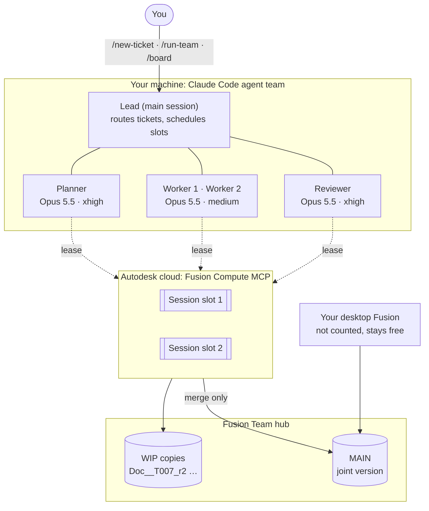
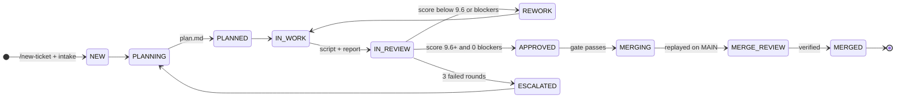

# Agentic CAD Fusion Team

**An AI design team for Autodesk Fusion.** A team of Claude Code agents plans, builds, reviews and merges changes to
your Fusion design in cloud sessions through the Fusion Compute MCP. Your own desktop Fusion stays free the whole time.


You describe a change in plain words, for example *"make the motor mount 2 mm thinner, keep the screw pattern"*.
- The **planner** turns it into a measured, step-by-step plan.
- A **worker** builds it in a copy of your design in the cloud.
- A strict **reviewer** measures the result and scores it.

Only changes that score **≥ 9.6/10 with zero blockers** reach your main design. A merge is verified, and you can roll it
back.

```
/new-ticket Make the motor mount 2 mm thinner, keep the screw pattern
/run-team                        # the team works until the board is empty
/board                           # status at any time
```

---

## Why this approach

### 1. Git for CAD: branches, replayable diffs, verified merges
Fusion cannot merge parallel edits to one document. Agentic CAD Fusion Team handles your design the way you'd handle a repository:

- **MAIN** is the joint version. Only merge tasks write to it, and only after approval.
- **Every change is a script.** A worker copies MAIN at a recorded base version into a WIP folder and runs one
  TypeScript change script on that copy. The reviewed result is exactly *MAIN@base + script*, so the diff is code: you
  can read it, replay it and review it.
- **Merges are verified.** The approved script is replayed on MAIN. If MAIN moved on in the meantime (for example you
  saved a change yourself), a rebase dry-run runs first. Afterwards an inventory diff must match the approved submission
  within tolerance: mass ±0.1 %, bounding boxes ±0.01 mm, identical sets of bodies, joints and parameters, and zero
  timeline errors.
- **Rollback is built in.** Each merge records the pre-merge version; restoring it means promoting that version and
  saving a marker. Nothing is ever deleted from your hub.

### 2. A reviewer you have to convince
The reviewer is a separate agent running at the highest reasoning effort. Its instructions tell it to assume the
submission is flawed until its own measurements prove otherwise. It never trusts the worker's report and reproduces
every claim. Every round it checks:

- every acceptance criterion from the plan
- the inventory diff against the plan's *expected* diff (anything extra counts as a fragment)
- leftover bodies, sketches and parameters
- interference at each step while every affected joint is driven through its full range of motion
- a flex test of changed parameters
- recompute time against the baseline
- fabrication rules (walls, fits, holes)
- reproducibility of the script

The score is a weighted 1–10 with hard caps (any blocker caps it at 9.0). **The gate is enforced by hooks, not by
goodwill:** a merge task for a ticket that fails `scripts/check-review.sh` cannot even be created. Rework goes straight
back to the worker, and after three failed rounds the ticket escalates to the planner.

### 3. Tickets that run to completion without you
- **You are asked once, at intake.** `/new-ticket` asks right away about everything that would change the design.
  After that, no ticket waits for you. If a question comes up later, the planner decides by explicit, ordered decision
  rules, documents the decision and what would change otherwise, and work continues. Answer whenever you like; the
  team re-routes.
- **Merge gates** keep the big calls with you, for example envelope growth beyond a limit, new purchased parts or
  changed interface dimensions. The team still plans, builds and reviews the variant. Only the merge waits for your
  answer, and the team works on other tickets meanwhile.
- **A state machine and hooks keep the team honest.** A task cannot be completed without its artifacts (plan, script,
  report, review, merge verification). A teammate cannot go idle while holding a Fusion session. Every state change is
  logged.
- `/run-team` keeps routing until no ticket is open.

### 4. The right model for each job
Each role is a Claude Code agent definition with its own `model` and `effort` in the frontmatter. Reasoning goes where
mistakes are expensive, and the routine work runs lighter:

| Role | Default | Job |
|---|---|---|
| **Lead** | your main session | Routes tickets, schedules Fusion slots, talks to you. Never models or reviews. |
| **Planner** | Opus 5.5 · `xhigh` | Writes plans precise enough that a worker never makes a design decision. |
| **Worker ×2** | Opus 5.5 · `medium` | Executes the plan, self-tests, submits, does rework, merges. |
| **Reviewer** | Opus 5.5 · `xhigh` | Measures, scores and gates. |

Because the plans are complete, execution doesn't need the most expensive setting. Moving workers to a cheaper model is
a one-line change (see [Make it yours](#make-it-yours)).

### 5. Cloud compute in parallel, with your desktop free
- The **Fusion Compute MCP** runs headless Fusion in Autodesk's cloud. Two sessions run in parallel, so the reviewer can
  test ticket 3 while a worker builds ticket 4.
- **Verified: your desktop Fusion does not count against the cloud sessions.** Keep modelling locally while the team
  works. If you save MAIN yourself, the team treats that version as intended and rebases onto it.
- A **slot lease system** (`scripts/fusion-slot.sh`) shares the scarce sessions fairly:
  - priority queue: reviewer > merge > worker > planner, so finished work flows out first
  - handover to the next waiter on release
  - reaping of stale leases
- Agents prepare offline with the sessionless API index and claim a session only to run.

### 6. Objective and traceable
- `scripts/fusion/inventory.ts` captures the design state as JSON: components, bodies, sketches, joints and limits, user
  parameters, timeline health, mass, centre of mass, inertia and recompute time. `scripts/diff-inventory.py` turns two
  inventories into a markdown diff. Nothing is counted by hand.
- Each ticket keeps its plan, change scripts, reports, reviews, inventories and renders in one folder.
- Fusion version descriptions start with `[T### r<N>]`, so the hub history maps one-to-one to tickets.

### 7. Knowledge that compounds
[`fusion/capabilities.md`](fusion/capabilities.md) collects dozens of verified behaviours and pitfalls of the Fusion
Compute MCP and the Fusion API. Some examples:
- an exception does *not* roll back a script's edits
- a call over 300 s silently reloads the start document
- saving an opened old version is a no-op
- whole-assembly interference fails on large designs

Agents read the file before writing a script and record new findings after every session. That means fewer failed
sessions and fewer wasted tokens over time.

---

## Field notes
These come from the first deployment on a ~3,000-body robotics assembly. Four tickets went through the full flow, with
2–3 review rounds each and final scores of 9.7–9.8. Every merge passed inventory verification. Some catches that a
quick visual check would have missed:

- **A script that wasn't idempotent.** Re-running a change script added a duplicate material each time. Score 9.2,
  rework.
- **A wall below the fabrication minimum.** The reviewer measured 0.44 mm where the rules require 0.8 mm. This was a
  blocker; it was resolved as a documented exception that the user signed off.
- **About 40 sliver faces of 0.1 µm** left at boolean seams. Volume checks cannot see them. The plan was revised, and
  round 3 was approved.
- **A concurrent edit on MAIN.** The user saved a new version mid-review that changed parts inside the ticket's scope.
  The rebase dry-run stopped the merge before MAIN was touched, and a rebased round was reviewed and merged.

---

## How it works



**Ticket lifecycle.** Every transition goes through `scripts/ticket.sh` and is logged:



**Guard rails (Claude Code hooks)**
| Hook | Blocks |
|---|---|
| `TaskCreated` | task subjects outside the `[T###][TYPE]` convention; `[MERGE]` tasks whose review fails the gate |
| `TaskCompleted` | plans missing any of the 11 mandatory sections; work without change script or report; reviews without a parseable score; merges without verification or a refreshed snapshot; anything completed while the ticket still holds a Fusion session |
| `TeammateIdle` | going idle while holding a Fusion session lease |

---

## Quickstart

**You need**
- [Claude Code](https://claude.com/claude-code) with agent teams. They are experimental; this repo's
  `.claude/settings.json` enables them.
- An Autodesk account with access to the **Fusion Compute MCP** (public beta), and your design in a Fusion Team hub.
- `bash` and `python3` (macOS or Linux).

**Set up**
```bash
git clone https://github.com/SamedVossberg/agentic-cad-fusion-team.git my-design
cd my-design
claude
```
Then, in Claude Code:
1. `/mcp` → authenticate `fusion-cloud` with your Autodesk account.
2. `/setup-project` interviews you (where MAIN lives, fabrication rules, constraints, merge gates). It creates `project/`
   from the templates, runs a capability check on a throw-away copy and takes the first snapshot of MAIN.
3. `/new-ticket <what you want changed>` creates a ticket (one short intake round).
4. `/run-team` lets the team work until no ticket is open.
5. `/board` shows tickets, slot usage and the latest log lines.

**Watch it work**
- live: the agent panel and the shared task list (`Ctrl+T`)
- durable: `project/BOARD.md`, `project/work/T###/` (plans, reports, reviews with scores) and
  `project/log/DESIGN_LOG.md`
- in Fusion: the version history

---

## Repository layout
```
agentic-cad-fusion-team/
├── CLAUDE.md                  # shared protocol for every agent (imports project/PROJECT.md)
├── .claude/
│   ├── agents/                # planner.md · worker.md · reviewer.md — model + effort per role
│   ├── skills/                # /setup-project · /new-ticket · /run-team · /board
│   ├── hooks/                 # task-created · task-completed · teammate-idle
│   └── settings.json          # agent teams, permissions, hooks
├── .mcp.json                  # Fusion Compute MCP endpoint (fusion-cloud)
├── scripts/
│   ├── ticket.sh              # ticket state machine + board
│   ├── fusion-slot.sh         # cloud session leases, priorities, handover
│   ├── check-review.sh        # merge gate
│   ├── diff-inventory.py      # inventory diff + merge verification (--check)
│   └── fusion/                # inventory.ts, save-result.py, snapshot-md.py
├── fusion/capabilities.md     # verified Fusion Compute MCP knowledge (shared across projects)
├── templates/project-skeleton/  # blank forms (placeholders only) that /setup-project copies to project/
└── project/                   # YOUR design — git-ignored, never part of this repo
    ├── PROJECT.md             # merge gates, priorities, units, standing decisions
    ├── spec/                  # requirements, parameters, backlog
    ├── fusion/                # documents (URNs), notes, snapshot of MAIN
    ├── work/T###-slug/        # plan, change scripts, reports, reviews, artifacts
    ├── log/                   # design log, session log
    └── BOARD.md
```
Framework and project are strictly separated. You can pull framework updates without conflicts, version `project/`
separately (`git -C project init`, private), or symlink `project` to switch between designs.

---

## Make it yours

**Models and effort.** Edit the frontmatter of `.claude/agents/<role>.md`:
```yaml
---
name: worker
model: claude-sonnet-5-5   # default: claude-opus-5-5
effort: medium
---
```
The default (Opus 5.5 everywhere, `xhigh` for planner and reviewer) is the configuration the field notes come from. A
leaner, **untested** starting point: Sonnet 5.5 for the workers and for your lead session, with planner and reviewer
unchanged. Keep the default in-process teammate mode, because per-role effort only applies to in-process teammates. Don't
set `CLAUDE_CODE_SUBAGENT_MODEL` or `CLAUDE_CODE_EFFORT_LEVEL`, because they override the per-role settings.

**Other knobs**
| What | Where |
|---|---|
| Merge gates, decision priorities, units | `project/PROJECT.md` |
| Fabrication rules the reviewer enforces | `project/spec/requirements.md` |
| Envelope growth that needs your approval | `FUSION_GROWTH_GATE_MM` in `.claude/settings.local.json` → `env` |
| Number of cloud sessions | `FUSION_MAX_SLOTS` (default 2, the beta limit) |
| Review threshold and scoring | `scripts/check-review.sh`, `.claude/agents/reviewer.md`, CLAUDE.md "Review gate" |
| More workers | spawn list in `.claude/skills/run-team/SKILL.md` + names in CLAUDE.md "Communication" |

**Other CAD tools.** The process layer (tickets, leases, gates, hooks, roles) is CAD-agnostic. The Fusion-specific parts
are `scripts/fusion/`, `fusion/capabilities.md` and the MCP tool names. Swap those for any CAD tool that has a
scripting API and an MCP server.

---

## Good to know
- **Both platforms are in beta.** Agent teams are experimental in Claude Code. At the time of writing, the Fusion Compute
  MCP allows 2 concurrent sessions per Autodesk user, 1 h per session, and an auto-stop after 15 min idle; starts may
  queue. The protocol is built around these limits.
- **Thoroughness costs tokens.** Planner and reviewer at `xhigh` are not cheap, and a ticket with 2–3 review rounds is a
  substantial run. The team is worth it where correctness matters more than speed.
- **Your machine runs the team.** Fusion runs in the cloud, but the Claude Code session runs on your computer and has to
  stay running.
- **Report-file writes.** Claude Code sometimes refuses a teammate's write of a report file. `/run-team` asks once per
  session whether the lead may save such a file verbatim on the teammate's behalf.
- **Large assemblies.** Whole-assembly interference analysis fails beyond a few hundred occurrences. The protocol uses
  scoped checks against a recorded baseline instead.

## Contributing
Issues and pull requests are welcome, especially new verified entries for
[`fusion/capabilities.md`](fusion/capabilities.md) (please include the engine build and a minimal snippet).

## License
[MIT](LICENSE)
